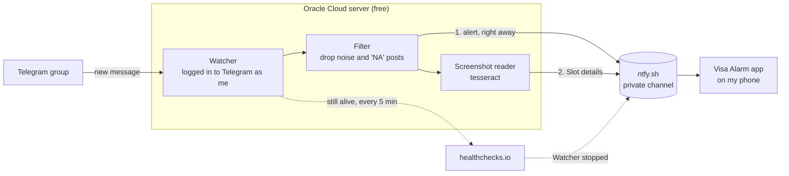

# H1B Appointment Watcher

US visa interview slots for H1B and H4 open up at random and are gone within minutes. People post them in the Telegram group **Regular_H1B_H4_VisaSlotsChecking**, but the group is busy and mostly noise, and Telegram stays quiet when the phone is on silent.

This project watches that group around the clock and rings a loud alarm on my Android phone the moment someone posts a real slot. It runs for free on an Oracle Cloud server, so my laptop can be off.

## How it works



There are three parts:

1. **The watcher** runs on the server. It is logged in to Telegram with my account and only reads the group. It never posts there.
2. **ntfy.sh** is a free push service. The watcher sends each alert to a private channel on it. The channel name is long and random, so it works like a password.
3. **The Visa Alarm app** on my phone keeps a connection open to that channel and sounds the alarm for every message that arrives.

**healthchecks.io** keeps an eye on the watcher. The watcher checks in every 5 minutes. If it stops checking in, healthchecks.io sends "Watcher stopped" to the same channel, so the phone rings for that too.

## What happens when someone posts

1. **A message arrives** in the group. If the watcher was offline for a bit, it picks up the missed messages when it reconnects, so alerts come late rather than never.
2. **The filter drops noise.** It skips the group's repeating "H1 H4 inperson slots availa..." notice, posts from anonymous admins, and anything that says "NA" or "N/A" as a word (that means "no slots"). City names like CHENNAI still get through.
3. **The phone rings right away.** The watcher sends the message text, or "New slot photo posted" if it was only a screenshot. This takes about a second.
4. **The screenshot gets read.** If there is a picture, the watcher reads the text in it and pulls out the city and dates. Nothing is guessed: if it can't find a city or a date, it skips this step. It gives up after 15 seconds.
5. **"Slot details" follows.** What it found goes out as a second message, for example `Hyderabad, 3 dates: Nov 4, 5, 12 2026`.

Reading the screenshot can take a few seconds, which is why the first alarm never waits for it.

## What shows up on the phone

| Someone posts | First message | Second message |
|---|---|---|
| Text only, like "Chennai 14 Nov" | Chennai 14 Nov | none |
| A screenshot with the caption "Hyd open now" | Hyd open now | Hyderabad, 3 dates: Nov 4, 5, 12 2026 |
| A screenshot with no caption | New slot photo posted | Hyderabad, 3 dates: Nov 4, 5, 12 2026 |
| A screenshot nothing can be read from | New slot photo posted | none |
| "Hyderabad NA" | nothing, it's skipped | none |

The app plays the alarm sound at full volume, vibrates and shows a red full-screen alert, even on silent or vibrate. It keeps ringing until I tap **Dismiss** or **Open Telegram**. If the second message arrives while it's still ringing, the notification text changes to the details. If I already dismissed the first one, it rings again.

## When something breaks

| What goes wrong | What I get |
|---|---|
| The watcher crashes | Nothing. The server restarts it after 30 seconds, and it picks up what it missed. |
| The Telegram login expires | An alarm saying "H1B watcher stopped: Telegram login" with the steps to log in again |
| The watcher or server stops, or loses Telegram | "Watcher stopped" from healthchecks.io, then "Watcher back" when it recovers |
| My phone loses its connection | Nothing to do. The app reconnects and fetches anything it missed. |
| A screenshot can't be read | The first alarm still rings, there is just no "Slot details" |

The watcher sends the same problem at most once every 6 hours, so a long outage doesn't keep waking me up.

## Where everything lives

- **The server:** Oracle Cloud, Always Free plan, San Jose region. The account was never upgraded, so it can't be charged. Its address is in `telegram-watcher/cloud/server_ip.txt`. The watcher runs as a service called `h1b-watcher` from `/opt/h1b-watcher`.
- **Private files on my Mac, in `~/.config/h1b-watcher/`:**
  - `.env`: the settings and passwords
  - `session.session`: the saved Telegram login. Anyone with this file can use my Telegram, so treat it like a password.
  - `VisaAlarm.apk`: a built copy of the phone app, so it can be reinstalled without building it again
- **Keys on my Mac:** `~/.ssh/oracle_h1b` to log in to the server, and `~/.oci/` for the Oracle account (only needed to create a new server).

None of the private files are in this repo. The server has its own copy of `.env` and `session.session`.

## Settings

The settings live in `.env`. The template is `telegram-watcher/.env.example`.

| Setting | What it's for | Where to get it |
|---|---|---|
| `API_ID`, `API_HASH` | Lets the watcher log in to Telegram | my.telegram.org, then "API development tools" |
| `SOURCE_GROUP` | The group to watch | Already set to `Regular_H1B_H4_VisaSlotsChecking` |
| `NTFY_TOPIC` | The private channel the app listens on | Make one up: `echo visa-alert-$(openssl rand -hex 8)` |
| `HEALTHCHECK_URL` | The check-in link for healthchecks.io | Your check's ping URL on healthchecks.io |
| `OCR_ENABLED` | Read screenshots for "Slot details" | `true` (default) or `false` |

## Setting it up from scratch

You need a Mac with Python 3 and the GitHub command line tool `gh`.

1. **Get the code and set it up.** This copies the private files in from `~/.config/h1b-watcher/`, installs what's needed and runs the tests.
   ```
   gh repo clone MeghnaNatraj/h1b-appointment-watcher
   cd h1b-appointment-watcher
   ./setup.sh
   ```
   With no `.env` yet, copy `telegram-watcher/.env.example` to `~/.config/h1b-watcher/.env`, fill it in, and run `./setup.sh` again.
2. **Log in to Telegram once.** Telegram sends a code the first time.
   ```
   cd telegram-watcher
   h1b_watcher_venv/bin/python h1b_slot_watcher.py
   ```
   Type the code, wait for "Watching group", press Ctrl+C, then keep a backup with `cp session.session ~/.config/h1b-watcher/`.
3. **Set up healthchecks.io.** Create a check with a 5 minute period and put its ping URL in `HEALTHCHECK_URL`. Then open Integrations, add a Webhook, and assign it to the check:
   - When it goes down: POST to `https://ntfy.sh/<NTFY_TOPIC>`, body `Visa slot watcher stopped. No slot alerts until it is fixed.`, headers `Title: Watcher stopped`, `Priority: urgent`, `Tags: warning`
   - When it comes back: POST to the same URL, body `Visa slot watcher is running again.`, headers `Title: Watcher back`, `Priority: low`
4. **Get a server.** `telegram-watcher/cloud/auto_setup.sh` asks Oracle for a free server, retrying every 3 minutes because free servers are often out of capacity, then installs everything on it and saves its address. It uses the `h1b` profile in `~/.oci/config`.
5. **Install the phone app.** See "The phone app" below.
6. **Test it.** Send a test alert (see "Everyday commands") and check that the phone rings.

## The phone app

Visa Alarm is a one-button app in `android-app/`. Open it and tap **START**. It asks for each permission it needs (notifications, full-screen alerts, no battery limits), then listens in the background and starts again on its own after a reboot. **Test alarm** shows what an alert looks like.

**To install it,** use the saved `~/.config/h1b-watcher/VisaAlarm.apk`, or build a new one (below). Either:

- **By cable:** on the phone, turn on Developer options (Settings, About phone, Software information, tap Build number 7 times), then turn on USB debugging. On Samsung, turn off Settings, Security and privacy, Auto Blocker first. Plug the phone in, tap Allow, then run `$ANDROID_HOME/platform-tools/adb install -r VisaAlarm.apk`.
- **Without a cable:** email the APK to yourself, open it on the phone and allow installing from Gmail.

**To build it** (only needed after changing the app or the channel name; the tools take about 2 GB):

```
brew install openjdk@17 gradle
brew install --cask android-commandlinetools
export JAVA_HOME=/opt/homebrew/opt/openjdk@17 ANDROID_HOME=/opt/homebrew/share/android-commandlinetools
yes | sdkmanager --licenses
sdkmanager "platforms;android-34" "build-tools;34.0.0" "platform-tools"
cd android-app
./gradlew assembleRelease -PntfyTopic=<your NTFY_TOPIC>
```

The new app is `android-app/app/build/outputs/apk/release/app-release.apk`. The channel name is built into it, so don't share it with anyone.

## Everyday commands

Run these from the repo folder. First set the server address:

```
IP=$(cat telegram-watcher/cloud/server_ip.txt)
```

| To... | Run |
|---|---|
| Check it's running | `ssh -i ~/.ssh/oracle_h1b opc@$IP systemctl is-active h1b-watcher` |
| See the last 50 log lines | `ssh -i ~/.ssh/oracle_h1b opc@$IP sudo journalctl -u h1b-watcher -n 50` |
| Restart it | `ssh -i ~/.ssh/oracle_h1b opc@$IP sudo systemctl restart h1b-watcher` |
| Ring the phone with a test alert | `ssh -i ~/.ssh/oracle_h1b opc@$IP 'sudo -u watcher /opt/h1b-watcher/venv/bin/python /opt/h1b-watcher/h1b_slot_watcher.py --test-alert'` |

Add your own text after `--test-alert` to change the message. The test never touches the Telegram login.

In the log, "Watching group" means it connected and "Alert sent" means an alert went out.

## Changing the code or settings

1. Edit the code in the repo, or the settings in `~/.config/h1b-watcher/.env`.
2. Run `./setup.sh` to pick up the settings and run the tests.
3. Send it to the server:
   ```
   telegram-watcher/cloud/deploy.sh $(cat telegram-watcher/cloud/server_ip.txt)
   ```

The deploy copies my local `.env` over the server's, so always change settings on the Mac, not on the server.

## If Telegram logs me out

The alarm says "H1B watcher stopped: Telegram login" and lists these steps:

1. Run step 2 of "Setting it up from scratch" to log in again on the Mac.
2. Remove the old login from the server: `ssh -i ~/.ssh/oracle_h1b opc@$IP sudo rm /opt/h1b-watcher/session.session`
3. Deploy, which copies the new login over: `telegram-watcher/cloud/deploy.sh $IP`
4. Keep the backup current: `cp telegram-watcher/session.session ~/.config/h1b-watcher/`

## If Oracle stops or deletes the server

Oracle sometimes stops free servers it thinks are idle. If "Watcher stopped" doesn't clear up on its own, log in to the Oracle Cloud console and start the server again. If it was deleted, run `telegram-watcher/cloud/auto_setup.sh` to get a new one.

## Rules it follows

- **Read only.** It never posts, reacts or messages anyone in the group.
- **One copy at a time.** Two copies using the same Telegram login can get the login cancelled, so only the server runs it. The Mac only runs it briefly to log in again.
- **No secrets in the repo.** `.env` and `session.session` are listed in `.gitignore`.
- **Free.** Oracle Always Free, ntfy.sh, healthchecks.io and tesseract all cost nothing.

## What's in the folders

```
h1b-appointment-watcher/
  README.md                 this file
  setup.sh                  one-time setup on a Mac
  docs/system-design.html   the full design, as a web page
  telegram-watcher/
    h1b_slot_watcher.py     the watcher
    slot_image.py           reads screenshots and writes the "Slot details" line
    test_*.py               tests
    requirements.txt        Python packages
    .env.example            settings template
    cloud/                  scripts that create the server and deploy to it
  android-app/              the Visa Alarm phone app (Java)
```

## Full design

The complete design, with the diagram, every component, what happens when each part fails and why it's built this way, is in [docs/system-design.html](docs/system-design.html). Download it and open it in a browser.

## Similar project

[us-visa-bot](https://github.com/jeangnc/us-visa-bot) takes a different approach: it logs in to your account on ais.usvisa-info.com and can rebook an earlier date by itself. I didn't use it because checking that often can lock the visa account, and rebooking automatically cancels the appointment you already have.

## Disclaimer

For personal use. It only reads a public group, but it does so with my Telegram account, so use it within Telegram's terms.
