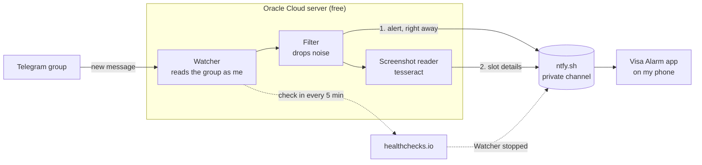

# H1B Appointment Watcher

H1B visa interview slots open at random and disappear in minutes. People post them in a Telegram group, but the group is noisy and Telegram stays silent when my phone is on silent.

This project watches the group around the clock and rings a loud alarm on my Android phone when someone posts a real slot. It runs free on an Oracle Cloud server.

## Design

- **Watcher** (`telegram-watcher/`): a Python script logged in to Telegram with my account. It only reads the group.
- **Filter:** skips "NA" replies, ghost slots, small talk and the group's repeating notice. Everything else rings.
- **Screenshot reader:** pulls the city and dates out of slot screenshots and sends them as a second alert, for example `Hyderabad, 3 dates: Nov 4, 5, 12 2026`.
- **ntfy.sh:** a free push service. Alerts go to a private channel whose random name works like a password.
- **Visa Alarm** (`android-app/`): rings at full volume with a red full-screen alert, even on silent, until dismissed.
- **healthchecks.io:** sends "Watcher stopped" to the same channel if the watcher goes quiet.

Full design: [docs/system-design.html](docs/system-design.html).

## Running it

Operating instructions (setup, deploy, building and installing the app, fixing problems) are in [AGENTS.md](AGENTS.md), written so Claude or another coding agent can do the work. Open the repo in Claude Code and ask, for example, "check the watcher is running" or "rebuild and install the phone app".

All private settings and logins stay in `~/.config/h1b-watcher/` and are never committed.

For personal use, within Telegram's terms.
