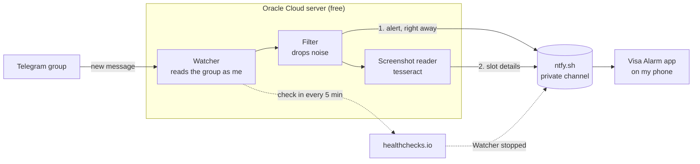

# H1B Appointment Watcher

H1B and H4 visa interview slots open at random and disappear in minutes. People post them in the Telegram group **Regular_H1B_H4_VisaSlotsChecking**, but the group is noisy and Telegram stays silent when my phone is on silent.

This project watches the group around the clock and rings a loud alarm on my Android phone when someone posts a real slot. It runs free on an Oracle Cloud server, so my laptop can be off.

## Design



- **Watcher** (`telegram-watcher/`): a Python script logged in to Telegram with my account. It only reads the group and never posts.
- **ntfy.sh**: a free push service. Alerts go to a private channel whose long random name works like a password.
- **Visa Alarm** (`android-app/`): keeps a connection open to that channel and rings for every message, even on silent.
- **healthchecks.io**: if the watcher stops checking in for 5 minutes, it sends "Watcher stopped" to the same channel.

The full design, including failure handling, is in [docs/system-design.html](docs/system-design.html).

## What triggers an alarm

The filter skips the group's repeating notice, anonymous admin posts, "NA" style "no slots" replies (N A, N/A, N.A.), anything with "ghost" in it, and greetings or small talk like "Hi" or "ok". Everything else rings.

1. **Right away:** the message text, or "New slot photo posted" for a screenshot.
2. **A few seconds later:** if there was a screenshot, the city and dates read from it, for example `Hyderabad, 3 dates: Nov 4, 5, 12 2026`. If nothing can be read, this step is skipped.

## The phone app

One screen with three controls:

- **ON/OFF box:** starts or stops listening. It asks for permissions the first time and restarts itself after a reboot.
- **Alarm sound:** Phone alarm, Horror scream or Movie scream (Wilhelm). The two screams are CC0 clips from Wikimedia Commons.
- **Test alarm:** plays the chosen sound with the red alert screen.

The alarm rings at full volume with vibration until I tap **Dismiss** or **Open Telegram**.

**Personal sounds.** My own build also offers **Vastuguna huiya** and **Pink Blush (Dolly Babe)**. These clips are not in the repo (see `.gitignore`). To include them, put `vastuguna.m4a` or `pinkblush.m4a` in `android-app/app/src/main/res/raw/` before building. Without them the choices are hidden.

**Install:** copy `~/.config/h1b-watcher/VisaAlarm.apk` to the phone (email it to yourself, or use `adb install -r VisaAlarm.apk` over USB).

**Build** (about 2 GB of tools):

```
brew install openjdk@17 gradle
brew install --cask android-commandlinetools
export JAVA_HOME=/opt/homebrew/opt/openjdk@17 ANDROID_HOME=/opt/homebrew/share/android-commandlinetools
yes | sdkmanager --licenses
sdkmanager "platforms;android-34" "build-tools;34.0.0" "platform-tools"
cd android-app
./gradlew assembleRelease -PntfyTopic=<your NTFY_TOPIC>
```

The APK lands in `android-app/app/build/outputs/apk/release/`. The channel name is built in, so don't share it.

## Setup

You need a Mac with Python 3 and `gh` (the GitHub command line tool).

1. **Clone and set up.** `setup.sh` copies private files from `~/.config/h1b-watcher/`, installs packages and runs the tests.
   ```
   gh repo clone MeghnaNatraj/h1b-appointment-watcher
   cd h1b-appointment-watcher
   ./setup.sh
   ```
   With no `.env` yet, copy `telegram-watcher/.env.example` to `~/.config/h1b-watcher/.env`, fill it in, and run `./setup.sh` again.
2. **Log in to Telegram once.** Run `h1b_watcher_venv/bin/python h1b_slot_watcher.py` in `telegram-watcher/`, type the code Telegram sends, wait for "Watching group", press Ctrl+C, then back up the login with `cp session.session ~/.config/h1b-watcher/`.
3. **healthchecks.io.** Create a check with a 5 minute period, put its ping URL in `HEALTHCHECK_URL`, and add a webhook that POSTs to `https://ntfy.sh/<NTFY_TOPIC>` with the header `Title: Watcher stopped` when it goes down.
4. **Server.** `telegram-watcher/cloud/auto_setup.sh` requests a free Oracle server (retrying while capacity is short), installs the watcher and saves the address to `telegram-watcher/cloud/server_ip.txt`.
5. **Phone.** Install the app and tap **Test alarm**.

**Settings** live in `~/.config/h1b-watcher/.env`:

| Setting | Purpose |
|---|---|
| `API_ID`, `API_HASH` | Telegram login, from my.telegram.org |
| `SOURCE_GROUP` | The group to watch |
| `NTFY_TOPIC` | The private channel, for example `visa-alert-$(openssl rand -hex 8)` |
| `HEALTHCHECK_URL` | The healthchecks.io ping URL |
| `OCR_ENABLED` | Read screenshots, `true` by default |

## Everyday commands

Set `IP=$(cat telegram-watcher/cloud/server_ip.txt)` first.

| To | Run |
|---|---|
| Check it's running | `ssh -i ~/.ssh/oracle_h1b opc@$IP systemctl is-active h1b-watcher` |
| See recent logs | `ssh -i ~/.ssh/oracle_h1b opc@$IP sudo journalctl -u h1b-watcher -n 50` |
| Restart | `ssh -i ~/.ssh/oracle_h1b opc@$IP sudo systemctl restart h1b-watcher` |
| Send a test alert | `ssh -i ~/.ssh/oracle_h1b opc@$IP 'sudo -u watcher /opt/h1b-watcher/venv/bin/python /opt/h1b-watcher/h1b_slot_watcher.py --test-alert'` |
| Deploy changes | `./setup.sh && telegram-watcher/cloud/deploy.sh $IP` |

Deploy copies the Mac's `.env` over the server's, so change settings on the Mac.

## When something breaks

| Problem | Fix |
|---|---|
| Watcher crashes | Nothing to do. The server restarts it in 30 seconds and it catches up on missed messages. |
| Alarm says "Telegram login" | Redo setup step 2, run `ssh -i ~/.ssh/oracle_h1b opc@$IP sudo rm /opt/h1b-watcher/session.session`, then deploy. |
| "Watcher stopped" doesn't clear | Oracle may have stopped the server. Start it in the Oracle console, or run `auto_setup.sh` if it was deleted. |
| Phone loses connection | Nothing to do. The app reconnects and fetches what it missed. |

The same problem alerts at most once every 6 hours.

## Rules

- **Read only:** never posts or reacts in the group.
- **One copy:** only the server runs the watcher, since two copies on one Telegram login can get it cancelled.
- **No secrets in the repo:** `.env`, `session.session`, keys (`~/.ssh/oracle_h1b`, `~/.oci/`) and the APK stay on the Mac.
- **Free:** Oracle Always Free, ntfy.sh, healthchecks.io and tesseract cost nothing.

For personal use, within Telegram's terms.
